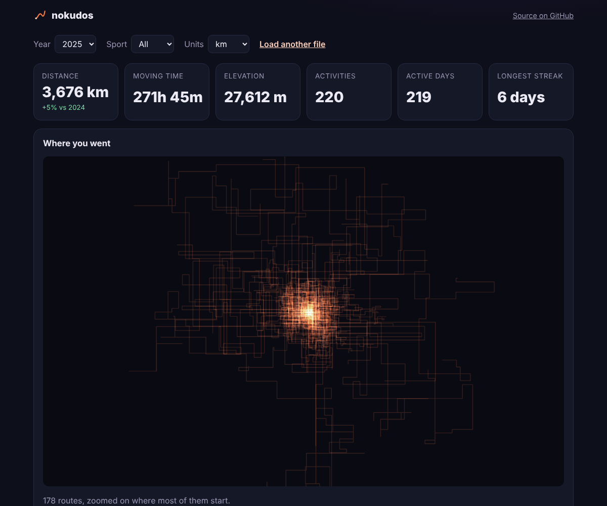

# nokudos

[](https://github.com/AstralunaProject/nokudos/actions/workflows/ci.yml)
[](LICENSE)

**Free Strava & Garmin year in review from your data export. Heatmap, stats, PRs and share cards, 100% in your browser.**

**[Open nokudos →](https://astralunaproject.github.io/nokudos/)** · no login, no upload, works with free accounts. No export yet? Try the sample data button.



## What you get

- **Totals:** distance, moving time, elevation, activities, active days, longest streak, and the change from the year before
- **Route heatmap:** every GPS track drawn over itself and zoomed on where most activities start, with no map tiles fetched
- **Personal bests from the GPS tracks:** 1 km, 1 mile, 5 km, 10 km, half marathon and marathon for runs; 10, 20, 40 and 100 km for rides
- **Month-by-month chart**, a calendar of every active day, a breakdown by sport, the longest activity and the biggest climb
- **Share card:** a 1080×1350 PNG to download or send straight to an app from your phone
- Filters by year and sport; km or miles

## Your data stays on your device

The ZIP never leaves the browser. It is read piece by piece in a Web Worker, so large exports load without freezing the page. There is no server, no account and no analytics. The page loads only its own files, so you can check this in the network tab.

## Getting your export

| Service | Where | What arrives |
| --- | --- | --- |
| Strava | Settings → My Account → *Download or Delete Your Account* → *Request Your Archive* | ZIP with `activities.csv` and an `activities/` folder of FIT, GPX and TCX files |
| Garmin Connect | Account → Data Management → *Export Your Data* | ZIP with `summarizedActivities.json` and the original FIT files in nested ZIPs |

Keep Strava's language on English when you request the archive: the headers of `activities.csv` are written in it.

## How it reads the files

| File | Notes |
| --- | --- |
| `activities.csv` (Strava) | The header repeats `Distance` and `Elapsed Time`. The second copy is always in meters and seconds, and that is the one used. Dates are in UTC and shown in your time zone. |
| `summarizedActivities.json` (Garmin) | The export uses centimeters for distance and elevation and milliseconds for durations, unlike the Connect API. |
| `.fit`, `.fit.gz` | Own decoder for the FIT protocol: GPS records and sport, with compressed timestamp headers; developer fields are skipped. |
| `.gpx`, `.tcx`, `.gz` | Track points and times. Decompression uses the browser's native `DecompressionStream`. |
| ZIP | Own reader with ZIP64 support: only the central directory and the entries in use are read. |

GPS points that would require an impossible speed are dropped before computing bests. Activities without a track (treadmill, indoor, manual) count in the totals but not in the map or bests.

## Development

No build step and no runtime dependencies: plain ES modules, typed with JSDoc and checked by TypeScript.

```sh
npm install
npm run check   # TypeScript
npm test        # node:test, with synthetic Strava and Garmin exports
npm run serve   # http://localhost:8000
```

```
src/
  zip.js, csv.js, fit.js, gpx.js   file formats
  strava.js, garmin.js, load.js    export layouts
  geo.js                           distances, GPS cleanup, best efforts
  stats.js, format.js              year review and units
  heatmap.js, charts.js, card.js   drawing
  worker.js, app.js, demo.js       page
```

## License

[MIT](LICENSE). Not affiliated with Strava or Garmin.
